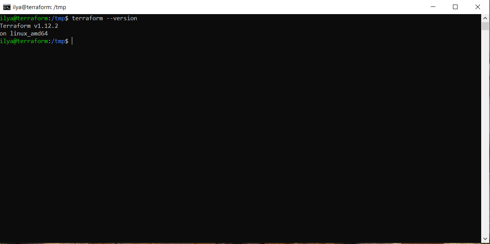
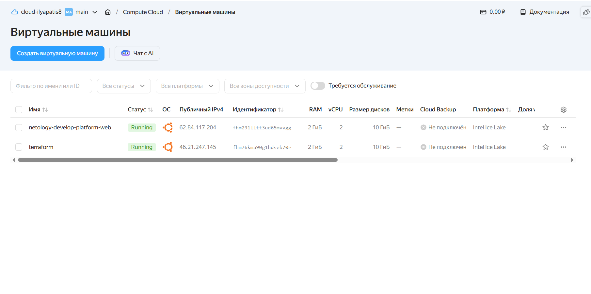
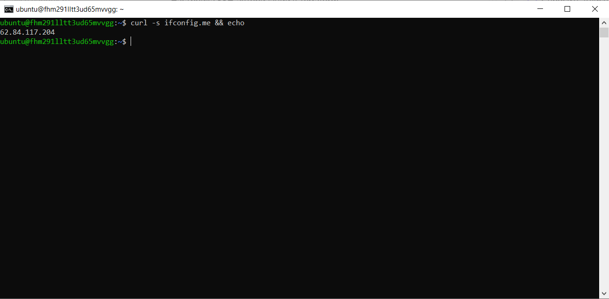
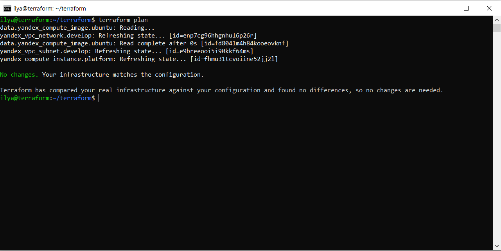
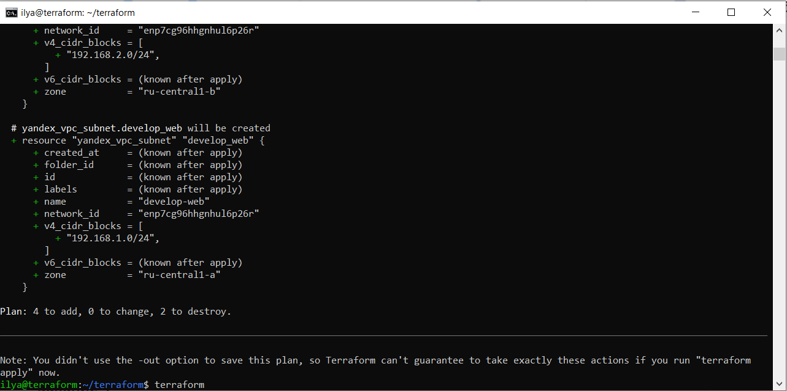
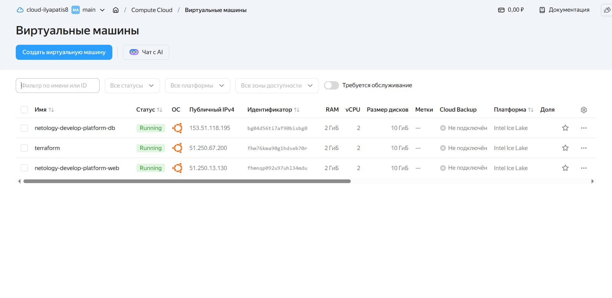
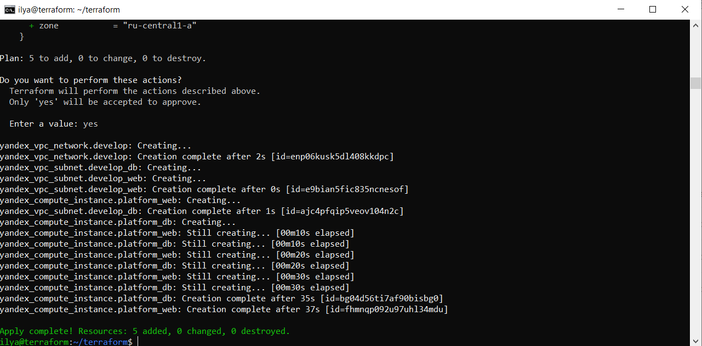
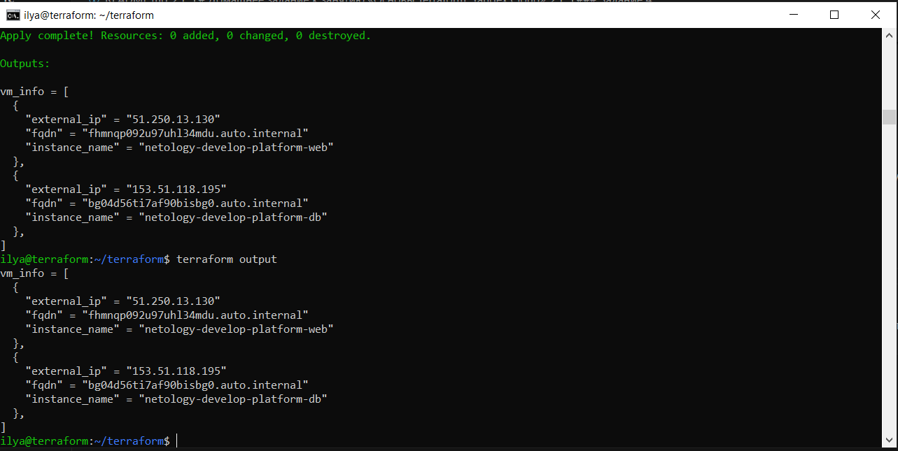
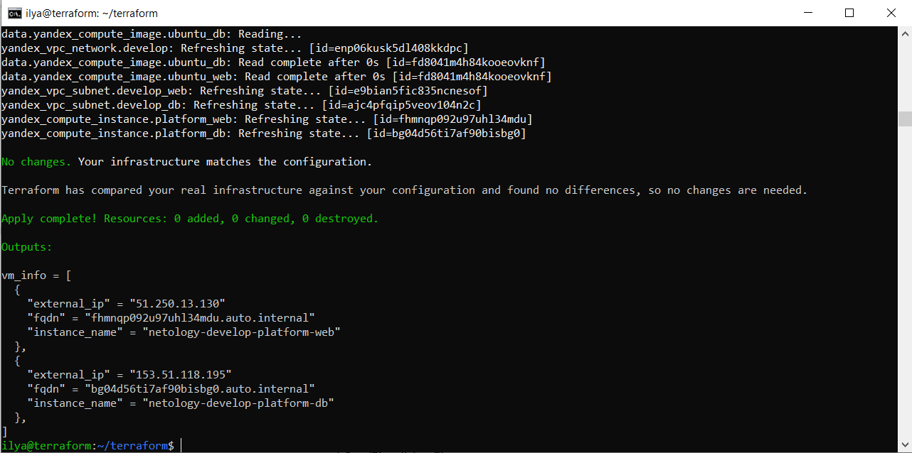
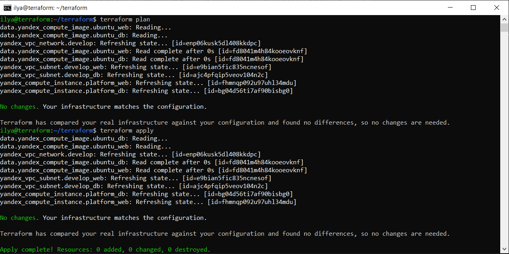

# Домашнее задание к занятию «Основы Terraform. Yandex Cloud»

### Цели задания

1. Создать свои ресурсы в облаке Yandex Cloud с помощью Terraform.
2. Освоить работу с переменными Terraform.


### Чек-лист готовности к домашнему заданию

1. Зарегистрирован аккаунт в Yandex Cloud. Использован промокод на грант.
2. Установлен инструмент Yandex CLI.
3. Исходный код для выполнения задания расположен в директории [**02/src**](https://github.com/netology-code/ter-homeworks/tree/main/02/src).


### Задание 0

1. Ознакомьтесь с [документацией к security-groups в Yandex Cloud](https://cloud.yandex.ru/docs/vpc/concepts/security-groups?from=int-console-help-center-or-nav).
Этот функционал понадобится к следующей лекции.

------
### Внимание!! Обязательно предоставляем на проверку получившийся код в виде ссылки на ваш github-репозиторий!
------

### Задание 1
В качестве ответа всегда полностью прикладывайте ваш terraform-код в git.
Убедитесь что ваша версия **Terraform** ~>1.12.0

```
cd /tmp
wget https://hashicorp-releases.yandexcloud.net/terraform/1.12.2/terraform_1.12.2_linux_amd64.zip
sudo apt update && sudo apt install -y unzip
unzip terraform_1.12.2_linux_amd64.zip
sudo mv /tmp/terraform /usr/local/bin/
terraform --version
```


1. Изучите проект. В файле variables.tf объявлены переменные для Yandex provider.
2. Создайте сервисный аккаунт и ключ. [service_account_key_file](https://terraform-provider.yandexcloud.net).

### Команды для установки Yandex Cloud и создания сервисного аккаунта и ключа

```
curl -sSL https://storage.yandexcloud.net/yandexcloud-yc/install.sh | bash
yc --version
yc init
yc iam service-account create --name admin --description "Service account for Terraform"

yc iam key create \
  --service-account-name admin \
  --output service_account_key_file.json
```
4. Сгенерируйте новый или используйте свой текущий ssh-ключ. Запишите его открытую(public) часть в переменную **vms_ssh_public_root_key**.

### Добавление ключа в переменную
Узнаем оболочку:
```
echo $SHELL
```
если /bin/bash — используем ~/.bashrc, если /bin/zsh — ~/.zshrc.

```
nano ~/.bashrc
export TF_VAR_vms_ssh_public_root_key="$(cat ~/.ssh/id_ed25519.pub)"
source ~/.bashrc
echo "$vms_ssh_public_root_key"
```
5. Инициализируйте проект, выполните код. Исправьте намеренно допущенные синтаксические ошибки. Ищите внимательно, посимвольно. Ответьте, в чём заключается их суть.

Ответ: проект проинициализировался. При запуске возникают ошибки в файле `main.tf`:
    - `platform_id = "standart-v4"` -> `platform_id = "standard-v3"` # опечатка в слове `standard` и неверная версия (допустимы v1, v2, v3);
    - `cores         = 1` -> `cores         = 2` # минимальное количество виртуальных ядер должно быть равно 2;
    - core_fraction задаётся в процентах, но при cores = 1 это вообще не имеет смысла, а при cores = 2 значение 5% — это очень мало и часто не поддерживается на практике для обычных ВМ.

6. Подключитесь к консоли ВМ через ssh и выполните команду ``` curl ifconfig.me```.
Примечание: К OS ubuntu "out of a box, те из коробки" необходимо подключаться под пользователем ubuntu: ```"ssh ubuntu@vm_ip_address"```. Предварительно убедитесь, что ваш ключ добавлен в ssh-агент: ```eval $(ssh-agent) && ssh-add``` Вы познакомитесь с тем как при создании ВМ создать своего пользователя в блоке metadata в следующей лекции.;
8. Ответьте, как в процессе обучения могут пригодиться параметры ```preemptible = true``` и ```core_fraction=5``` в параметрах ВМ.

Ответ:
 - preemptible = true - определяет прерываемость ВМ. Это виртуальные машины, которые могут быть принудительно остановлены в любой момент;
 - core_fraction=5 - определяет производительность в %. Этот уровень определяет долю вычислительного времени физических ядер, которую гарантирует vCPU.

Задание этих настроек помогает снизить стоимость ВМ.

В качестве решения приложите:

- скриншот ЛК Yandex Cloud с созданной ВМ, где видно внешний ip-адрес;


- скриншот консоли, curl должен отобразить тот же внешний ip-адрес;


```
curl -s ifconfig.me && echo
```

### Задание 2

1. Замените все хардкод-**значения** для ресурсов **yandex_compute_image** и **yandex_compute_instance** на **отдельные** переменные. К названиям переменных ВМ добавьте в начало префикс **vm_web_** .  Пример: **vm_web_name**.
2. Объявите нужные переменные в файле variables.tf, обязательно указывайте тип переменной. Заполните их **default** прежними значениями из main.tf.
3. Проверьте terraform plan. Изменений быть не должно.

### variables.tf
```
###cloud vars


variable "cloud_id" {
  type        = string
  default     = "b1gdg8jnk3itjgqs10v2"
  description = "https://cloud.yandex.ru/docs/resource-manager/operations/cloud/get-id"
}

variable "folder_id" {
  type        = string
  default     = "b1gj6oetvra83p5q8j1g"
  description = "https://cloud.yandex.ru/docs/resource-manager/operations/folder/get-id"
}

variable "default_zone" {
  type        = string
  default     = "ru-central1-a"
  description = "https://cloud.yandex.ru/docs/overview/concepts/geo-scope"
}
variable "default_cidr" {
  type        = list(string)
  default     = ["192.168.1.0/24"]
  description = "https://cloud.yandex.ru/docs/vpc/operations/subnet-create"
}

variable "vpc_name" {
  type        = string
  default     = "develop"
  description = "VPC network & subnet name"
}


###ssh vars

variable "vms_ssh_root_key" {
  type        = string
  default     = "<your_ssh_id_rsa_key>"
  description = "ssh-keygen -t rsa -b 4096"
}

### vm_web vars (для yandex_compute_image и yandex_compute_instance)
variable "vm_web_name" {
  type        = string
  default     = "netology-develop-platform-web"
  description = "Name of the web VM instance"
}

variable "vm_web_platform_id" {
  type        = string
  default     = "standard-v3"
  description = "Platform ID for the VM"
}

variable "vm_web_cores" {
  type        = number
  default     = 2
  description = "Number of CPU cores"
}

variable "vm_web_memory" {
  type        = number
  default     = 2
  description = "Memory in GB"
}

variable "vm_web_core_fraction" {
  type        = number
  default     = 20
  description = "Core fraction (in percent)"
}

variable "vm_web_image_family" {
  type        = string
  default     = "ubuntu-2404-lts"
  description = "Image family for the boot disk"
}

variable "vm_web_preemptible" {
  type        = bool
  default     = true
  description = "Enable preemptible VM"
}
```

### main.tf

```
resource "yandex_vpc_network" "develop" {
  name = var.vpc_name
}
resource "yandex_vpc_subnet" "develop" {
  name           = var.vpc_name
  zone           = var.default_zone
  network_id     = yandex_vpc_network.develop.id
  v4_cidr_blocks = var.default_cidr
}


data "yandex_compute_image" "ubuntu" {
  family = var.vm_web_image_family
}

resource "yandex_compute_instance" "platform" {
  name        = var.vm_web_name
  platform_id = var.vm_web_platform_id

  resources {
    cores         = var.vm_web_cores
    memory        = var.vm_web_memory
    core_fraction = var.vm_web_core_fraction
  }

  boot_disk {
    initialize_params {
      image_id = data.yandex_compute_image.ubuntu.image_id
    }
  }

  scheduling_policy {
    preemptible = var.vm_web_preemptible
  }

  network_interface {
    subnet_id = yandex_vpc_subnet.develop.id
    nat       = true
  }

  metadata = {
    serial-port-enable = 1
    ssh-keys           = "ubuntu:${var.vms_ssh_root_key}"
  }
}
```



### Задание 3

1. Создайте в корне проекта файл 'vms_platform.tf' . Перенесите в него все переменные первой ВМ.
2. Скопируйте блок ресурса и создайте с его помощью вторую ВМ в файле main.tf: **"netology-develop-platform-db"** ,  ```cores  = 2, memory = 2, core_fraction = 20```. Объявите её переменные с префиксом **vm_db_** в том же файле ('vms_platform.tf').  ВМ должна работать в зоне "ru-central1-b"
3. Примените изменения.

### vms_platform.tf

```
### vm_web vars (первая ВМ)
variable "vm_web_name" {
  type        = string
  default     = "netology-develop-platform-web"
  description = "Name of the web VM instance"
}

variable "vm_web_platform_id" {
  type        = string
  default     = "standard-v3"
  description = "Platform ID for the web VM"
}

variable "vm_web_cores" {
  type        = number
  default     = 2
  description = "CPU cores for the web VM"
}

variable "vm_web_memory" {
  type        = number
  default     = 2
  description = "Memory in GB for the web VM"
}

variable "vm_web_core_fraction" {
  type        = number
  default     = 20
  description = "Core fraction (in percent) for the web VM"
}

variable "vm_web_image_family" {
  type        = string
  default     = "ubuntu-2404-lts"
  description = "Image family for the web VM boot disk"
}

variable "vm_web_preemptible" {
  type        = bool
  default     = true
  description = "Enable preemptible mode for the web VM"
}

### vm_db vars (вторая ВМ)
variable "vm_db_name" {
  type        = string
  default     = "netology-develop-platform-db"
  description = "Name of the DB VM instance"
}

variable "vm_db_platform_id" {
  type        = string
  default     = "standard-v3"
  description = "Platform ID for the DB VM"
}

variable "vm_db_cores" {
  type        = number
  default     = 2
  description = "CPU cores for the DB VM"
}

variable "vm_db_memory" {
  type        = number
  default     = 2
  description = "Memory in GB for the DB VM"
}

variable "vm_db_core_fraction" {
  type        = number
  default     = 20
  description = "Core fraction (in percent) for the DB VM"
}

variable "vm_db_image_family" {
  type        = string
  default     = "ubuntu-2404-lts"
  description = "Image family for the DB VM boot disk"
}

variable "vm_db_preemptible" {
  type        = bool
  default     = false
  description = "Enable preemptible mode for the DB VM (usually false for DB)"
}
```

### main.tf
```
resource "yandex_vpc_network" "develop" {
  name = var.vpc_name
}

resource "yandex_vpc_subnet" "develop_web" {
  name           = "${var.vpc_name}-web"
  zone           = var.zone_a
  network_id     = yandex_vpc_network.develop.id
  v4_cidr_blocks =  var.cidr_a
}

resource "yandex_vpc_subnet" "develop_db" {
  name           = "${var.vpc_name}-db"
  zone           = var.zone_e
  network_id     = yandex_vpc_network.develop.id
  v4_cidr_blocks = var.cidr_e
}

data "yandex_compute_image" "ubuntu_web" {
  family = var.vm_web_image_family
}

data "yandex_compute_image" "ubuntu_db" {
  family = var.vm_db_image_family
}

# Web VM
resource "yandex_compute_instance" "platform_web" {
  name        = var.vm_web_name
  platform_id = var.vm_web_platform_id
  zone           = var.zone_a

  resources {
    cores         = var.vm_web_cores
    memory        = var.vm_web_memory
    core_fraction = var.vm_web_core_fraction
  }

  boot_disk {
    initialize_params {
      image_id = data.yandex_compute_image.ubuntu_web.image_id
    }
  }

  scheduling_policy {
    preemptible = var.vm_web_preemptible
  }

  network_interface {
    subnet_id = yandex_vpc_subnet.develop_web.id
    nat       = true
  }

  metadata = {
    serial-port-enable = 1
    ssh-keys           = "ubuntu:${var.vms_ssh_root_key}"
  }
}

# DB VM
resource "yandex_compute_instance" "platform_db" {
  name        = var.vm_db_name
  platform_id = var.vm_db_platform_id
  zone           = var.zone_e

  resources {
    cores         = var.vm_db_cores
    memory        = var.vm_db_memory
    core_fraction = var.vm_db_core_fraction
  }

  boot_disk {
    initialize_params {
      image_id = data.yandex_compute_image.ubuntu_db.image_id
    }
  }

  scheduling_policy {
    preemptible = var.vm_db_preemptible
  }

  network_interface {
    subnet_id = yandex_vpc_subnet.develop_db.id
    nat       = true
  }

  metadata = {
    serial-port-enable = 1
    ssh-keys           = "ubuntu:${var.vms_ssh_root_key}"
  }
}
```




### Задание 4

1. Объявите в файле outputs.tf **один** output , содержащий: instance_name, external_ip, fqdn для каждой из ВМ в удобном лично для вас формате.(без хардкода!!!)
2. Примените изменения.

В качестве решения приложите вывод значений ip-адресов команды ```terraform output```.

### [outputs.tf](src/outputs.tf)




### Задание 5

1. В файле locals.tf опишите в **одном** local-блоке имя каждой ВМ, используйте интерполяцию ${..} с НЕСКОЛЬКИМИ переменными по примеру из лекции.
2. Замените переменные внутри ресурса ВМ на созданные вами local-переменные.
3. Примените изменения.

### main.tf

```
resource "yandex_vpc_network" "develop" {
  name = var.vpc_name
}

resource "yandex_vpc_subnet" "develop_web" {
  name           = "${var.vpc_name}-web"
  zone           = var.zone_a
  network_id     = yandex_vpc_network.develop.id
  v4_cidr_blocks =  var.cidr_a
}

resource "yandex_vpc_subnet" "develop_db" {
  name           = "${var.vpc_name}-db"
  zone           = var.zone_e
  network_id     = yandex_vpc_network.develop.id
  v4_cidr_blocks = var.cidr_e
}

data "yandex_compute_image" "ubuntu_web" {
  family = var.vm_web_image_family
}

data "yandex_compute_image" "ubuntu_db" {
  family = var.vm_db_image_family
}

# Web VM
resource "yandex_compute_instance" "platform_web" {
  name        = local.web
  platform_id = var.vm_web_platform_id
  zone           = var.zone_a

  resources {
    cores         = var.vm_web_cores
    memory        = var.vm_web_memory
    core_fraction = var.vm_web_core_fraction
  }

  boot_disk {
    initialize_params {
      image_id = data.yandex_compute_image.ubuntu_web.image_id
    }
  }

  scheduling_policy {
    preemptible = var.vm_web_preemptible
  }

  network_interface {
    subnet_id = yandex_vpc_subnet.develop_web.id
    nat       = true
  }

  metadata = {
    serial-port-enable = 1
    ssh-keys           = "ubuntu:${var.vms_ssh_root_key}"
  }
}

# DB VM
resource "yandex_compute_instance" "platform_db" {
  name        = local.db
  platform_id = var.vm_db_platform_id
  zone           = var.zone_e

  resources {
    cores         = var.vm_db_cores
    memory        = var.vm_db_memory
    core_fraction = var.vm_db_core_fraction
  }

  boot_disk {
    initialize_params {
      image_id = data.yandex_compute_image.ubuntu_db.image_id
    }
  }

  scheduling_policy {
    preemptible = var.vm_db_preemptible
  }

  network_interface {
    subnet_id = yandex_vpc_subnet.develop_db.id
    nat       = true
  }

  metadata = {
    serial-port-enable = 1
    ssh-keys           = "ubuntu:${var.vms_ssh_root_key}"
  }
}
```



### Задание 6

1. Вместо использования трёх переменных  ".._cores",".._memory",".._core_fraction" в блоке  resources {...}, объедините их в единую map-переменную **vms_resources** и  внутри неё конфиги обеих ВМ в виде вложенного map(object).
   ```
   пример из terraform.tfvars:
   vms_resources = {
     web={
       cores=2
       memory=2
       core_fraction=5
       hdd_size=10
       hdd_type="network-hdd"
       ...
     },
     db= {
       cores=2
       memory=4
       core_fraction=20
       hdd_size=10
       hdd_type="network-ssd"
       ...
     }
   }
   ```
2. Создайте и используйте отдельную map(object) переменную для блока metadata, она должна быть общая для всех ваших ВМ.
   ```
   пример из terraform.tfvars:
   metadata = {
     serial-port-enable = 1
     ssh-keys           = "ubuntu:ssh-ed25519 AAAAC..."
   }
   ```

3. Найдите и закоментируйте все, более не используемые переменные проекта.
4. Проверьте terraform plan. Изменений быть не должно.



### [locals.tf](src/locals.tf)
### [vms_platform.tf](src/vms_platform.tf)
### [main.tf](src/main.tf)

### main.tf
```
resource "yandex_vpc_network" "develop" {
  name = var.vpc_name
}

resource "yandex_vpc_subnet" "develop_web" {
  name           = "${var.vpc_name}-web"
  zone           = var.zone_a
  network_id     = yandex_vpc_network.develop.id
  v4_cidr_blocks =  var.cidr_a
}

resource "yandex_vpc_subnet" "develop_db" {
  name           = "${var.vpc_name}-db"
  zone           = var.zone_e
  network_id     = yandex_vpc_network.develop.id
  v4_cidr_blocks = var.cidr_e
}

data "yandex_compute_image" "ubuntu_web" {
  family = var.vm_web_image_family
}

data "yandex_compute_image" "ubuntu_db" {
  family = var.vm_db_image_family
}

# Web VM
resource "yandex_compute_instance" "platform_web" {
  name        = local.web
  platform_id = var.vm_web_platform_id
  zone           = var.zone_a

  resources {
    cores         = var.vms_resources["web"].cores
    memory        = var.vms_resources["web"].memory
    core_fraction = var.vms_resources["web"].core_fraction
  }

  boot_disk {
    initialize_params {
      image_id = data.yandex_compute_image.ubuntu_web.image_id
    }
  }

  scheduling_policy {
    preemptible = var.vm_web_preemptible
  }

  network_interface {
    subnet_id = yandex_vpc_subnet.develop_web.id
    nat       = true
  }

  metadata = local.vms_metadata
}

# DB VM
resource "yandex_compute_instance" "platform_db" {
  name        = local.db
  platform_id = var.vm_db_platform_id
  zone           = var.zone_e

  resources {
    cores         = var.vms_resources["db"].cores
    memory        = var.vms_resources["db"].memory
    core_fraction = var.vms_resources["db"].core_fraction
  }

  boot_disk {
    initialize_params {
      image_id = data.yandex_compute_image.ubuntu_db.image_id
    }
  }

  scheduling_policy {
    preemptible = var.vm_db_preemptible
  }

  network_interface {
    subnet_id = yandex_vpc_subnet.develop_db.id
    nat       = true
  }

  metadata = local.vms_metadata
}
```

### locals.tf
```
locals {
  web = "${ var.name }-${ var.env }-${ var.project }-${ var.role[0] }"
  db = "${ var.name }-${ var.env }-${ var.project }-${ var.role[1] }"
  vms_metadata = {
    "serial-port-enable" = "1"
    "ssh-keys"           = "ubuntu:${var.vms_ssh_public_root_key}"
  }
}
```

### vms_platform.tf
```
### vm_web vars (первая ВМ)
#variable "vm_web_name" {
# type        = string
# default     = "netology-develop-platform-web"
# description = "Name of the web VM instance"
#}

variable "vm_web_platform_id" {
  type        = string
  default     = "standard-v3"
  description = "Platform ID for the web VM"
}

#variable "vm_web_cores" {
# type        = number
# default     = 2
# description = "CPU cores for the web VM"
#}

#variable "vm_web_memory" {
# type        = number
# default     = 2
# description = "Memory in GB for the web VM"
#}

#variable "vm_web_core_fraction" {
# type        = number
# default     = 20
# description = "Core fraction (in percent) for the web VM"
#}

variable "vm_web_image_family" {
  type        = string
  default     = "ubuntu-2404-lts"
  description = "Image family for the web VM boot disk"
}

variable "vm_web_preemptible" {
  type        = bool
  default     = true
  description = "Enable preemptible mode for the web VM"
}

### vm_db vars (вторая ВМ)
#variable "vm_db_name" {
# type        = string
# default     = "netology-develop-platform-db"
# description = "Name of the DB VM instance"
#}

variable "vm_db_platform_id" {
  type        = string
  default     = "standard-v3"
  description = "Platform ID for the DB VM"
}

#variable "vm_db_cores" {
# type        = number
# default     = 2
# description = "CPU cores for the DB VM"
#}

#variable "vm_db_memory" {
# type        = number
# default     = 2
# description = "Memory in GB for the DB VM"
#}

#variable "vm_db_core_fraction" {
# type        = number
# default     = 20
# description = "Core fraction (in percent) for the DB VM"
#}

variable "vm_db_image_family" {
  type        = string
  default     = "ubuntu-2404-lts"
  description = "Image family for the DB VM boot disk"
}

variable "vm_db_preemptible" {
  type        = bool
  default     = false
  description = "Enable preemptible mode for the DB VM (usually false for DB)"
}

variable "vms_resources" {
  type = map(object({
    cores = number
    memory = number
    core_fraction = number
  }))
  default = {
    web = {
      cores         = 2
      memory        = 2
      core_fraction = 20
    }
    db = {
      cores         = 2
      memory        = 2
      core_fraction = 20
    }
  }
}
```
------
